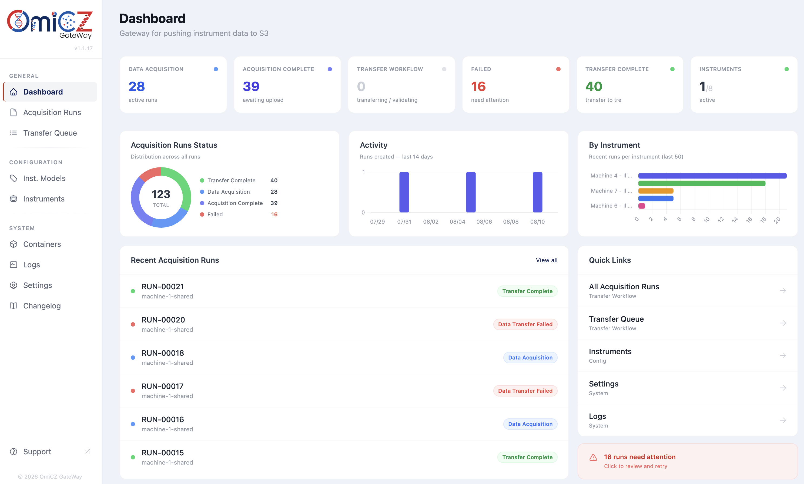
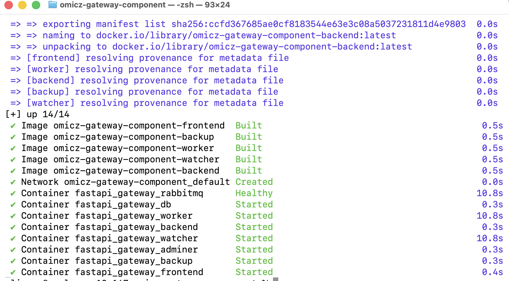
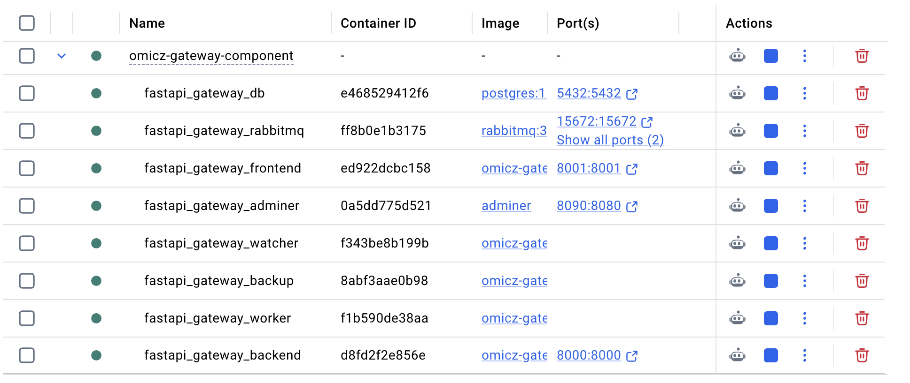
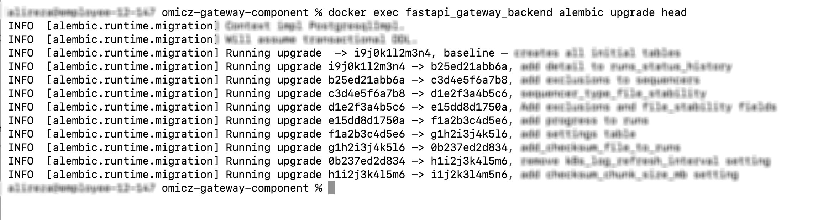

# OmiCZ Gateway

A web application that moves raw data from sequencers and mass spectrometers into a trusted research environment (TRE). It watches the instrument output folders on a facility computer, detects when a run is complete, writes a SHA256 checksum file for the run, uploads the run to the TRE's S3 inbox, and waits until the TRE confirms that every file arrived intact.



**[Try the interactive demo →](https://bioit-ceitec.github.io/omicz-gateway-component/)** a static copy of the web interface with sample data, so you can click through every page without installing anything.

**TRE side:** the receipts that confirm each run are written by the [OmiCZ inbox bucket watcher](https://github.com/BioIT-CEITEC/omicz-inbox-bucket-watcher-component), which runs inside the TRE. You do not install it on the facility computer; the TRE operators run it.

---

## Contents

1. [What it does](#what-it-does)
2. [Requirements](#requirements)
3. [How it works](#how-it-works-overview)
4. [Try it with test data](#try-it-with-test-data-no-instrument-no-tre) — no instrument and no TRE needed
5. [Installation](#installation) — Steps 1–6
6. [First-time configuration in the UI](#first-time-configuration-in-the-ui) — Steps A–C
7. [Run status reference](#run-status-reference)
8. [Adding a new machine later](#adding-a-new-machine-later)
9. [Updating](#updating)
10. [Troubleshooting](#troubleshooting)

---

## What it does

- Watches the output folders of configured instruments for new run folders
- Detects when a run is complete in one of three ways:
  - **Signal file**: the instrument writes a known file at the end (e.g. `RTAComplete.txt` on Illumina, `final_summary_*.txt` on Oxford Nanopore)
  - **File stability**: chosen files stop changing for a set time (e.g. `analysis.tdf` in a Bruker timsTOF `.d` folder)
  - **Directory stability**: each top-level folder of a run is sent once it stops changing, and the run is complete when nothing in it has changed for a set time
- Writes a SHA256 checksum file (`<hash>.CHECKSUM`) listing every file of the run. It is kept outside the run folder: instrument folders are mounted read-only and never changed
- Uploads the run to S3, skipping excluded files (e.g. thumbnails), and uploads the checksum file last
- Waits for the TRE's receipt and marks the run **Transfer Complete** only when the TRE has found every file
- Sends runs automatically or after a click, per instrument; retries resume without re-sending finished files
- Web UI with user login: instruments, runs, transfer queue, logs and live progress

---

## Requirements

- A computer that can read the instrument output folders (a local disk or a mounted network share): Linux, macOS or Windows
- Docker with Docker Compose v2 (the `docker compose` command):
  - Linux: [Docker Engine](https://docs.docker.com/engine/install/) (recommended for servers; faster than Docker Desktop for large runs)
  - macOS / Windows: [Docker Desktop](https://docs.docker.com/get-docker/), or [Rancher Desktop](https://rancherdesktop.io/) with the dockerd container engine
- [Git](https://git-scm.com/downloads), to download and update the code
- About 5 GB of free disk space for the images and the database. Runs are not copied, so they need no extra space
- Network access from this computer to the TRE's S3 endpoint (some TREs allow it only over a VPN)
- S3 settings from the TRE operators: endpoint URL, access key, secret key, the bucket and folder for uploads, and the bucket and folder for receipts

To only try the gateway, Docker and Git are enough: see [Try it with test data](#try-it-with-test-data-no-instrument-no-tre).

---

## How it works (overview)

The app runs as a set of Docker containers on your computer. It needs to know where your sequencer machine saves its output folders. You tell it this by setting a path in a `.env` file. Docker then makes that folder visible to the app containers, and the app watches it for new runs.

```
Your computer's folder  →  Docker volume mount  →  App sees it as /runs/machine-1
e.g. /data/illumina          (docker-compose.yml)
```

---

## Try it with test data (no instrument, no TRE)

A local demo runs the whole pipeline on the small synthetic runs in [`examples/runs`](examples/README.md): an Illumina-style run, a Nanopore-style run and a timsTOF-style `.d` folder, one for each kind of completion rule. Uploads go to a local S3 server, and a stand-in for the TRE checks every file and writes the receipt. Nothing leaves your computer, and the demo is separate from a real installation: its own containers (`fastapi_gateway_*-demo`), database and volumes. Only the web interface is published, on `127.0.0.1:18001` (set `DEMO_PORT` to change it).

```bash
git clone https://github.com/BioIT-CEITEC/omicz-gateway-component.git
cd omicz-gateway-component
docker compose -f docker-compose.demo.yml up -d --build
```

Open **http://localhost:18001** and log in as **demo** / **demo**. The three instruments are already set up, and the three runs reach **Transfer Complete** within about 2 minutes.

**What to look at**

- **Acquisition runs**: each run with its state. Open a run to see its status history, with a timestamp for every step from detection to the TRE confirmation.
- **Instruments** and **Inst. Models**: the completion rule of each demo instrument, and the exclusion patterns of the Illumina one (`Thumbnail_Images`, `*.png`).
- **Logs**: the watcher detecting the runs and the worker hashing and uploading them.
- **What the TRE received**: the files of each run, its manifest and its receipt:

  ```bash
  docker exec fastapi_gateway_tre_standin-demo python /demo/show_tre.py
  ```

  The Illumina run arrives with 6 of its 8 files: the two thumbnail images are excluded.

**Try more:** copy a run folder under a new name, e.g. `cp -r examples/runs/illumina/260101_DEMO_0001_AFAKE01 examples/runs/illumina/260101_DEMO_0002_AFAKE02`; the gateway detects it within 2 minutes and sends it. `examples/make_test_runs.py` also writes larger runs (see [examples/README.md](examples/README.md)); keep them small in the demo, because the local S3 server holds everything in memory.

**Remove the demo** (containers, database, volumes and images):

```bash
docker compose -f docker-compose.demo.yml down -v --rmi local
```

---

## Installation

Follow these steps in order. Each step explains what you are doing and why.

---

### Step 1 — Clone the repository

Download the project code to your computer:

```bash
git clone https://github.com/BioIT-CEITEC/omicz-gateway-component.git
cd omicz-gateway-component
```

---

### Step 2 — Tell the app where the instrument writes its runs

The gateway needs one folder per instrument: the folder in which the instrument creates a new subfolder for every run. Point it at that parent folder, not at a single run:

```
/data/sequencers/machine-1/              <- MACHINE_1_PATH points here
├── 260101_A01234_0001_AHXXXXXX/         <- one run (a run folder)
├── 260102_A01234_0002_AHYYYYYY/         <- the next run
└── ...
```

Create the `.env` file in the project folder from the example:

Linux / macOS:
```bash
cp .env.example .env
```
Windows (Command Prompt):
```cmd
copy .env.example .env
```

Open `.env` and set `MACHINE_1_PATH` to the real folder on this computer:

```env
# Linux / macOS
MACHINE_1_PATH=/data/sequencers/machine-1

# Windows
MACHINE_1_PATH=C:\Sequencer\Machine1
```

`docker-compose.yml` already mounts this folder into the containers, read-only, as `/runs/machine-1`:

```yaml
  - ${MACHINE_1_PATH}:/runs/machine-1:ro
#   ^ folder on this computer   ^ path inside the containers
```

Remember `/runs/machine-1`: it is what you enter as **Location** when you add the instrument in the UI (Step B). `:ro` means read-only: the app never writes into instrument folders. For a second instrument, see [Adding a new machine later](#adding-a-new-machine-later); put extra folders in `docker-compose.override.yml`, not in `docker-compose.yml`, so updates never conflict with your changes.

**Checksum files — nothing to fill in.** Before uploading a run, the worker writes a checksum file (`<hash>.CHECKSUM`) listing the SHA256 of every file in the run, and uploads it last. It is written to the `checksums/` folder in the project folder, not into the run folder. `docker-compose.yml` sets this up in the `worker` service:

```yaml
environment:
  CHECKSUM_DIR: /checksums        # path inside the container — do not change
volumes:
  - ./checksums:/checksums        # left side: folder on this computer
```

Docker creates `checksums/` on the first start. To keep the files elsewhere, change only the left side in `docker-compose.override.yml`, e.g. `- /data/omicz-checksums:/checksums` under `worker: volumes:`. The files are small, and you can delete them once a run is confirmed.

---

### Step 3 — Create the backend `.env` file

The backend needs its own configuration file for S3 credentials and database settings.

Linux / MacOS:
```bash
cp backend/.env.example backend/.env
```
Windows (Command Prompt):
```cmd
copy backend\.env.example backend\.env
```

Open `backend/.env` and fill in your S3 settings (you get these from the TRE operators):

```env
S3_ENDPOINT=https://your-s3-proxy-url
S3_ACCESS_KEY=your_access_key
S3_SECRET_KEY=your_secret_key
S3_REGION=us-east-1
S3_BUCKET=your-bucket-name           # where run data is uploaded
S3_PREFIX=raw_run_data/              # folder in that bucket
S3_CHECKSUM_BUCKET=your-bucket-name  # where the TRE confirms each run
S3_CHECKSUM_PREFIX=checksums/        # folder in that bucket
```

`S3_CHECKSUM_BUCKET` and `S3_CHECKSUM_PREFIX` are not where the app writes its checksum files (those stay on this computer, see Step 2). They tell the app where to look for the TRE's confirmation: after checking a run, the TRE writes an empty file with the same name as the run's checksum file there.

The database settings in this file can be left as-is — they match the database container defined in `docker-compose.yml`.

Optionally, name the first administrator of the web interface here. Otherwise you create it on the setup page the first time you open the UI (Step 6):

```env
ADMIN_USERNAME=admin
ADMIN_PASSWORD=choose-a-long-password
```

Use a password of at least 8 characters; the UI asks for 8 or more when a password is changed. To keep the password out of this file, leave both lines out and use the setup page instead.

**Check the connection to S3 before you go on** (optional): from this computer, `curl -I https://your-s3-proxy-url` should print an HTTP status line. If it hangs, the network or VPN to the TRE is not set up yet; the gateway will start, but uploads will fail.

---

### Step 4 — Build and start the containers

This downloads the required images (PostgreSQL, RabbitMQ) and builds the application containers. It takes a few minutes the first time. Run below command in root of the project.

```bash
docker compose up -d --build
```

You should see output like this once it finishes:



What this starts:

| Container | Purpose |
|-----------|---------|
| `fastapi_gateway_db` | PostgreSQL database — stores sequencers, runs, history |
| `fastapi_gateway_rabbitmq` | Message queue — passes events between services |
| `fastapi_gateway_backend` | REST API — the brain of the application |
| `fastapi_gateway_frontend` | Web UI — what you see in the browser |
| `fastapi_gateway_worker` | Processes run events — does checksumming and S3 upload |
| `fastapi_gateway_watcher` | Watches the sequencer folders for new runs |
| `fastapi_gateway_backup` | Backup service for the application |
| `fastapi_gateway_adminer` | GUI for PostgreSQL — only started with `docker compose --profile admin up -d` |


To check that all containers are running:

```bash
docker ps
```

All 7 containers should show `Up` (8 with the `admin` profile). You can also check in Docker Desktop:



---

### Step 5 — Run database migrations

This creates all the database tables. Only needed the first time (or after an update that includes schema changes).

```bash
docker exec fastapi_gateway_backend alembic upgrade head
```

You should see output like:
```
INFO  [alembic.runtime.migration] Running upgrade ...
```



---

### Step 6 — Open the web UI

| Service | URL | Login |
|---------|-----|-------|
| **Frontend (main UI)** | http://localhost:8001 | your user account |
| Backend API docs | http://localhost:8000/docs | access token (see below) |
| RabbitMQ management | http://localhost:15672 | guest / guest |
| Adminer (database UI) | http://localhost:8090 | see below; only with `--profile admin` |

Only the web UI (port 8001) is reachable from other computers. The API, RabbitMQ, the database and Adminer listen on `127.0.0.1`, so they can be opened only on the server itself (for example through an SSH tunnel).

**Login.** The first time you open the UI it asks you to create the first administrator, unless `ADMIN_USERNAME` / `ADMIN_PASSWORD` were set in `backend/.env`. Administrators add further users and reset passwords under **Users**; everyone sets their first and last name and changes their password under **Account** (click your name in the sidebar, above **Log out**). Only administrators can manage users. The web UI has no access to Docker; restart or update the containers on the server with `docker compose`.

A login keeps you signed in for 7 days of inactivity: the browser holds a 15-minute access token and a 7-day refresh token in HttpOnly cookies, and the access token is renewed automatically. Changing a password or disabling a user ends that user's sessions. If the UI is served over HTTPS (for example behind a reverse proxy), the cookies are marked Secure automatically; set `COOKIE_SECURE=true` in the frontend environment to force it.

**Forgot the only administrator password?** On the server, set a new `ADMIN_USERNAME` / `ADMIN_PASSWORD` in `backend/.env` and restart the backend (`docker restart fastapi_gateway_backend`): a new administrator with that name is created, and it can reset the old account under **Users**.

**Adminer login:**
- System: `PostgreSQL`
- Server: `db`
- Username: `postgres`
- Password: `postgres`
- Database: `fastapi_gateway_db`

---

## First-time configuration in the UI

After the app is running, tell it about your instruments in the web interface. You do this once per instrument model (Step A) and once per instrument (Step B). Nothing needs a restart.

---

### Step A — Create an Instrument Model

An **Instrument Model** says how to recognise that a run is complete. Create one per model of instrument, not per machine: two NovaSeq machines share one model.

Go to **Inst. Models → Create**.

| Field | What to enter |
|-------|--------------|
| **Name** | A label for the model, e.g. `Illumina NovaSeq 6000` |
| **Completion Method** | **Signal File**, **File Stability** or **Directory Stability** (see below) |
| **Signal Filename** | *Signal File only:* the file the instrument writes when the run ends |
| **Match Rule** | *Signal File only:* **Exact** (the whole name), **Prefix** (the name starts with it) or **Suffix** (the name ends with it) |
| **Files to Monitor** | *File Stability only:* files in the run folder to watch for size changes |
| **Stable after (minutes)** | *File Stability only:* how long those files must stay unchanged (default 10) |
| **Send a folder after (minutes)** | *Directory Stability only:* how long a top-level folder must stay unchanged before it is sent (default 10) |
| **Run complete after (minutes)** | *Directory Stability only:* how long the whole run must stay unchanged before it is complete (default 60) |

**Settings for common instruments** (the demo uses the same ones):

| Instrument | Completion Method | Settings |
|-----------|-------------------|----------|
| Illumina (NovaSeq, NextSeq, MiSeq, …) | Signal File | Signal Filename `RTAComplete.txt`, Match Rule **Exact** |
| Oxford Nanopore (MinKNOW) | Signal File | Signal Filename `final_summary_`, Match Rule **Prefix** |
| Bruker timsTOF (`.d` folders) | File Stability | Files to Monitor `analysis.tdf`, Stable after `10` |
| An instrument that writes nothing at the end | File Stability or Directory Stability | see below |

The signal file and the monitored files must be directly in the run folder, not in a subfolder.

**Completion methods in more detail:**

- **Signal File** — the instrument creates a known file when the run is done. The app checks each run folder for it.
- **File Stability** — the app watches the listed files and declares the run complete when none of them has changed in size for the set time. Use it for instruments that write no completion file. Choose a time longer than any pause of the instrument.
- **Directory Stability** — for long runs that should start uploading before they end. Each top-level folder of a run (e.g. `RUN_009/DIR1`) is sent to S3 on its own once no file in it has changed for **Send a folder after** minutes. The run is complete when nothing in the whole run folder has changed for **Run complete after** minutes; files in the run root, the rest of the data and the `.CHECKSUM` are then sent as usual, reusing the checksums of folders already sent. Folders are sent early only when **Transfer to TRE** is **Auto**.
  Files already in S3 cannot be overwritten. If a folder that was already sent changes later (a file modified or deleted), the run goes to **Transfer Conflict** and the run page lists the changed files. New files added to a sent folder are fine — they are sent once the folder is quiet again. Choose a folder time longer than any pause of the instrument.

---

### Step B — Create an Instrument

An **Instrument** is one physical machine whose output folder you mounted in Step 2.

Go to **Instruments → Create**.

| Field | What to enter | Example |
|-------|--------------|---------|
| **Name** | A label for this machine | `NovaSeq 1` |
| **Location** | The folder **inside the container**, from Step 2 — always starts with `/runs/` | `/runs/machine-1` |
| **Instrument Model** | The model you created in Step A | `Illumina NovaSeq 6000` |
| **Status** | Leave **Active** | Active |
| **Transfer to TRE** | **Auto**: upload as soon as a run is complete. **Manual**: wait until you click **Transfer to TRE** on the run page | Manual for the first run |
| **Exclusions** | Files, folders or patterns to skip during upload *(optional)* | `Thumbnail_Images`, `*.png` |

**Location is not a path on your computer.** It is the right side of the volume line from Step 2:

```yaml
- ${MACHINE_1_PATH}:/runs/machine-1:ro
#   ^ your computer   ^ container path (put this in Location)
```

If you enter a path that is not mounted, the instrument is marked **inaccessible** in the **Instruments** list.

> After saving, the watcher picks up the instrument within 60 seconds. Run folders that are already in the folder are added as well, and with **Auto** the complete ones are sent too. If the folder holds old runs you do not want to send, start with **Manual**.

---

### Step C — Check the first run

1. Open **Acquisition Runs**. Each run folder of the instrument appears with its state. A run that is still being written shows **Data Acquisition**; a finished one moves to **Acquisition Complete**.
2. Open a finished run and click **Transfer to TRE** (with **Auto** this happens by itself). The run goes through **Integrity Check** (hashing), **Data Transfer** (upload, with a progress bar) and **Transfer Validation** (waiting for the TRE's receipt).
3. The run reaches **Transfer Complete** when the TRE has confirmed every file. How long this takes depends on the TRE; the run page shows a timestamp for every step.
4. If a run stops in **Data Transfer Failed** or **Transfer Validation Failed**, see the table below; **Logs** in the navigation shows what the watcher and the worker did.

When the first run went through, switch the instrument to **Auto** if you want runs sent without a click.

---

## Run status reference

Once an instrument is configured, the app detects new runs automatically. You can monitor them under **Acquisition Runs** in the navigation.

```
Data Acquisition → Acquisition Complete → Integrity Check → Data Transfer → Transfer Validation → Transfer Complete
                                                            ↘ Data Transfer Failed              ↘ Transfer Validation Failed
```

| Status | What it means | What to do |
|--------|--------------|------------|
| `Data Acquisition` | New run folder detected, data acquisition in progress | Wait |
| `Acquisition Complete` | Machine finished; waiting to start upload | Click **Transfer to TRE** (if Manual) |
| `Integrity Check` | Generating SHA256 checksum file for the run | Wait |
| `Queued` | Waiting after previous upload is finished | Wait |
| `Data Transfer` | Uploading the run folder to S3 | Wait |
| `Transfer Validation` | Waiting for the TRE system to confirm receipt | Wait |
| `Transfer Complete` | Run fully uploaded and confirmed | Done |
| `Data Transfer Failed` | Upload failed | Click **Retry Upload** |
| `Transfer Validation Failed` | TRE verification failed | Click **Retry Verification** |
| `Transfer Conflict` | *Directory stability only:* a folder changed after it was sent | Check the instrument output; **Finalize anyway**, or delete the run and contact the TRE administrator |

---

## Adding a new machine later

If a new sequencer machine is connected to this computer:

1. **Add its path to `.env`:**
   ```env
   MACHINE_2_PATH=/data/sequencers/new-machine
   ```

2. **Add its volume in `docker-compose.override.yml`** — not in `docker-compose.yml`.
   Docker Compose loads this file automatically, and it is git-ignored, so an update never conflicts with it. Create it once from the example:
   ```bash
   cp docker-compose.override.example.yml docker-compose.override.yml
   ```
   The example already mounts `${MACHINE_2_PATH}` as `/runs/machine-2` in the `backend`, `worker`, and `watcher` services. For more machines, add one line per machine to each of those three services.

3. **Restart the full stack** (needed for Docker to pick up the new volume):
   ```bash
   docker compose down && docker compose up -d
   ```

4. **Create a new Instrument in the UI** with Location `/runs/machine-2`

> **Already added machines by editing `docker-compose.yml`?** That still works, but `git pull` can refuse to run when the new version changes the same file. Move your lines into `docker-compose.override.yml`, run `git checkout docker-compose.yml`, and update again.

---

## Updating

**Settings → How to update** shows the commands to run on the server. Open a terminal there and run them one by one:

```bash
cd ~/omicz-gateway-component
git checkout -- backend/core/config.py backend/services/worker.py docker-compose.yml
git pull
docker compose up -d --build
docker compose restart frontend
docker exec fastapi_gateway_backend alembic upgrade head
```

- `restart frontend` makes the UI show the new version: the frontend sees only the `VERSION` file, and a file mount keeps showing the old file until the container restarts.
- The `git checkout` line discards local edits to those three files. Keep your own instrument folders in `docker-compose.override.yml`, which is git-ignored.
- The restart interrupts running transfers. Retry resumes them without re-sending finished files.
- After the update that adds the login, the UI shows the setup page until the first administrator exists. Run `docker compose up -d` once so the new port settings (API, database and RabbitMQ on this host only) take effect, and remove the old Adminer container, which `up -d` leaves running: `docker rm -f fastapi_gateway_adminer`.

---

## Troubleshooting

**Containers not starting:**
```bash
docker compose logs
```

**Instrument storage shown as inaccessible** (common on Docker Desktop after a network share was remounted or the computer woke from sleep): remount the storage, then recreate the containers that read it so they bind the folder again:
```bash
docker compose up -d --force-recreate backend worker watcher
```

**One service has errors:**
```bash
docker logs fastapi_gateway_backend
docker logs fastapi_gateway_worker
docker logs fastapi_gateway_watcher
```

**Run stuck / not progressing:**
Check the worker logs — the worker processes all upload events:
```bash
docker logs fastapi_gateway_worker --tail 50
```

---

## After code changes

| What changed | Command to apply it |
|---|---|
| Python code in `backend/` or `frontend/` | `docker restart fastapi_gateway_backend fastapi_gateway_frontend` |
| `worker.py` or `watcher.py` | `docker restart fastapi_gateway_worker fastapi_gateway_watcher` |
| Database schema (new migration) | `docker exec fastapi_gateway_backend alembic upgrade head` |
| `Dockerfile` or `requirements.txt` | `docker compose build <service> && docker compose up -d <service>` |
| Settings in the UI | No restart needed — applied at runtime |
